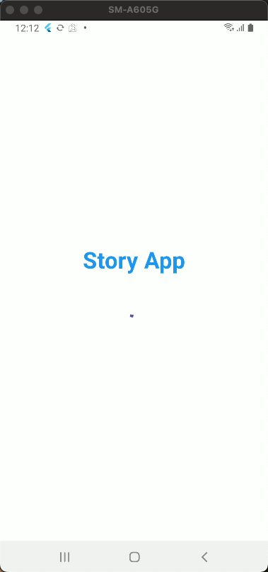
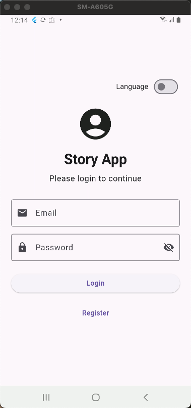
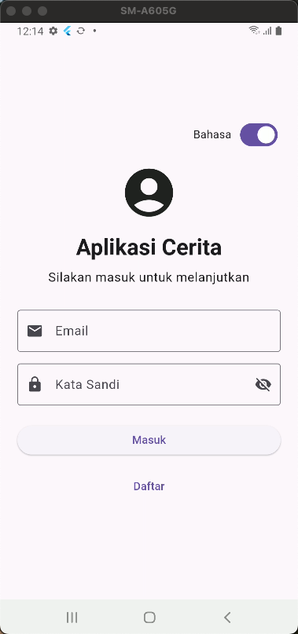
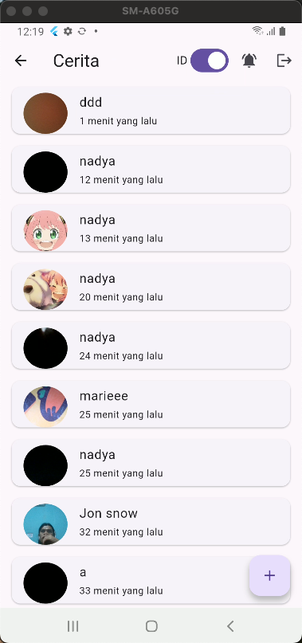
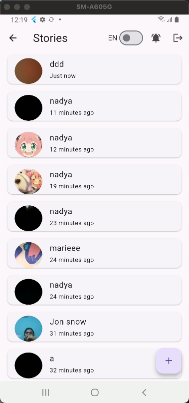
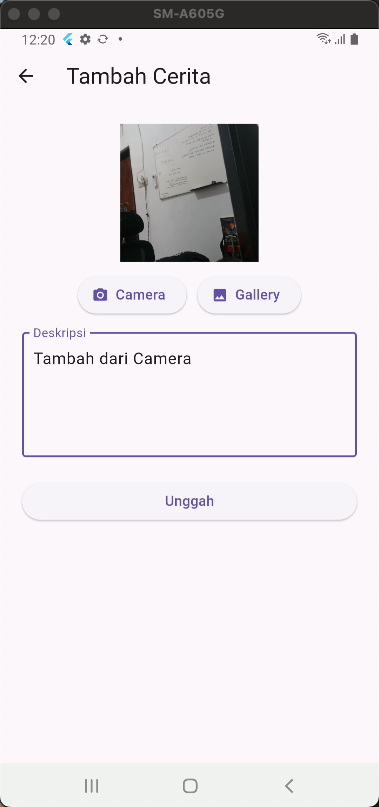
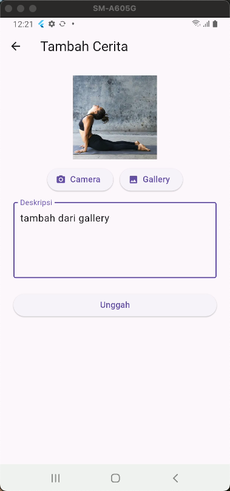
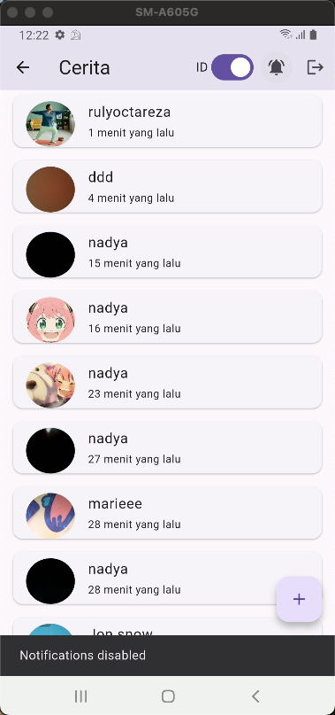

<p align="center">
  
</p>

<h1 align="center">Dicoding Story App</h1>

<p align="center">
  <b>Bagikan cerita, lihat cerita orang lain, lengkap dengan lokasi.</b><br>
  Dwibahasa (EN/ID) dan notifikasi latar belakang.
</p>

<p align="center">
  <a href="https://flutter.dev"></a>
  
  
  
</p>

---

## ✨ Preview

<p align="center">
  
</p>

<table align="center">
  <tr>
    <td></td>
    <td></td>
    <td></td>
    <td></td>
  </tr>
  <tr>
    <td align="center">Splash</td>
    <td align="center">Login (EN)</td>
    <td align="center">Login (ID)</td>
    <td align="center">Stories (ID)</td>
  </tr>
</table>

<table align="center">
  <tr>
    <td></td>
    <td></td>
    <td></td>
    <td></td>
  </tr>
  <tr>
    <td align="center">Stories (EN)</td>
    <td align="center">Add story — kamera</td>
    <td align="center">Add story — galeri</td>
    <td align="center">Notifikasi</td>
  </tr>
</table>

---

## 📖 Tentang

Aplikasi berbagi cerita dengan foto, peta lokasi, dan dukungan dua bahasa. Dibangun dengan
Flutter, `go_router` untuk navigasi, `provider` untuk state, serta `workmanager` untuk
notifikasi latar belakang.

---

## 🌟 Fitur

- **Story sharing** — unggah cerita dengan gambar dari kamera atau galeri
- **Story discovery** — jelajahi cerita pengguna lain dengan timestamp
- **Autentikasi** — login dan registrasi
- **Multibahasa** — Inggris dan Bahasa Indonesia (l10n)
- **Peta & lokasi** — `google_maps_flutter` dan `location`
- **Notifikasi pintar** — notifikasi latar belakang untuk cerita baru
- **Flavors** — konfigurasi build per environment

---

## 🛠️ Tech Stack

| Area | Pilihan |
|---|---|
| Framework | Flutter |
| State management | Provider |
| Routing | GoRouter |
| Peta | Google Maps Flutter |
| Latar belakang | Workmanager + local notifications |
| Lokalisasi | `flutter_localizations` + l10n |
| Media | `image_picker` |

---

## 🚀 Menjalankan

```bash
flutter pub get
flutter gen-l10n
flutter run
```

Siapkan API key Google Maps dan konfigurasi project sesuai flavors yang dipakai.

---

## 🧪 Testing

```bash
flutter analyze
flutter test
```
